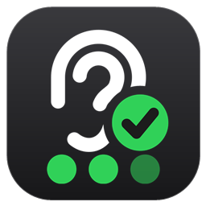
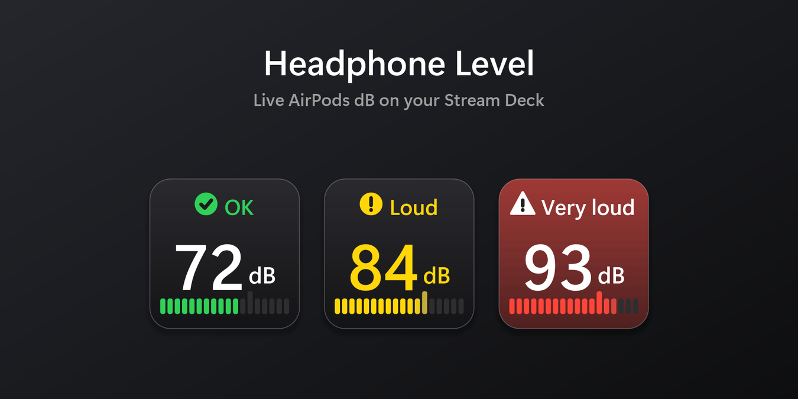

#  Headphone Level 

**Like the headphone level on iPhone, but on your Windows PC: hover over the ear in the taskbar and see live how loud your AirPods are right now.**

   

Green means relaxed, yellow from 80 dB means "maybe turn it down", red from 90 dB means "your ears are filing a complaint". The bar pulses with the beat, your AirPods stay in music mode, and the only thing measured is what Windows already sends to them. No account, no fuss, one icon in the taskbar.

**⬇ Free:** [Releases](https://github.com/Hendrik4K/Kopfhoererpegel/releases/latest) → `Kopfhoererpegel.exe` (tray app) and `Headphone-Level.streamDeckPlugin` (double-click installs it in Stream Deck).
**⭐ Like it? Leave a star!**
Want to support it? The same Stream Deck version is available for €0.99 on the Elgato Marketplace.

<b>🚀 Quick start</b>

1. Download `Kopfhoererpegel.exe` from **Releases** and put it in a permanent place (e.g. `Documents\Kopfhoererpegel`). If Windows SmartScreen says "Windows protected your PC": **More info → Run anyway** (the exe is not code-signed).
2. Start it. As soon as your AirPods are connected, the ear appears at the bottom right of the taskbar (if it lands in the ^ overflow, just drag it onto the taskbar).
3. Hover: level. Left click: the card stays open. Right click: settings, tick "Mit Windows starten" (start with Windows). Done.

The Windows app's interface is in German for now; the Stream Deck plugin follows the Stream Deck language (English or German).

**Stream Deck:** double-click `Headphone-Level.streamDeckPlugin`, then drag "Level" or "History" from the "Headphone Level" category onto a key.

<b>💡 What it does</b>

- **Live level in dB(A)** Status with icon (OK · Loud from 80 dB · Very loud from 90 dB), dB value and 18 segments from 20 to 110 dB, the front ones pulse with the beat.
- **Frosted card like on iPhone** Big round corners, softly blurred background, fades in and out gently. Stays open while the mouse is on the icon or the card.
- **A tray icon that plays along** Ear with a green check, yellow exclamation mark or red warning triangle, with three dots in time with the music below. Without AirPods it simply disappears.
- **AirPods stay in music mode** Measured via loopback; the hands-free channel is never opened, so no switch to phone-call quality.
- **Stream Deck** The same display on a key, press it to see the last 60 seconds, the key flashes red when it gets very loud.
- **Linux too** A Python/Qt version with the same card, see [`linux/`](linux/README.md).

<ins>Why this exists:</ins> On my iPhone I check the headphone level all the time, on the PC there was nothing like it. Now there is.

<b>⚙️ Settings</b>

Right-click the ear and the card turns into the settings:

- **Mit Windows starten** (start with Windows) to tick.
- **Kalibrierung** (calibration): hover over it and **−1 dB**, **+1 dB** and **↺** (default 106 dB) unfold. To calibrate, play the same song on your iPhone and your PC at the same volume and compare.
- **Beenden** (quit, the big button) and **Neu starten** (restart) below it.

Move the mouse away from the card and the icon and the card fades out. Settings are stored in `%LOCALAPPDATA%\Kopfhoererpegel\einstellungen.txt`.

<b>🎛️ Stream Deck</b>

Plugin `streamdeck/de.hendrik4k.kopfhoererpegel.sdPlugin`: drag the "Level" action onto a key.
The key shows the status with a badge, the dB value (in the status colour when loud or very loud) and the 18-segment bar, whose front
segments pulse with the beat like on the card. Pressing it switches to the last 60 seconds (bars in the status colour,
dashed line at 80 dB) and back. Without AirPods: ear + "Not connected".

The plugin measures by itself (`src/Meter.cs` + `src/CoreAudio.cs` are compiled in), so it also works without the tray app,
and reads the same calibration from `einstellungen.txt`. It only measures while a key is visible.
Errors go to `%LOCALAPPDATA%\Kopfhoererpegel\streamdeck.log`.

- `streamdeck\Bauen.ps1` builds the EXE and pictures into the plugin folder
- `-Installieren` copies it to `%APPDATA%\Elgato\StreamDeck\Plugins` and restarts Stream Deck
- `-Paket` creates `Kopfhoererpegel.streamDeckPlugin` (double-click installs it on any PC)
- `kopfhoererpegel-streamdeck.exe --render <folder>` saves all key states as PNG
- Two actions: "Level" and "History" (the Marketplace requires at least 2); the key flashes red when very loud.
  Texts on the key follow the Stream Deck language (English/German).

**Elgato Marketplace**

- Validate and pack with the Elgato CLI (`npm install -g @elgato/cli`):
  `streamdeck validate de.hendrik4k.kopfhoererpegel.sdPlugin` and `streamdeck pack de.hendrik4k.kopfhoererpegel.sdPlugin`
- `kopfhoererpegel-streamdeck.exe --store streamdeck\marketplace` creates the thumbnail and 3 gallery images (1920 × 960)
- Texts for the Maker Console: `streamdeck/marketplace/listing.md`

<b>📏 How it measures</b>

Like on iPhone it is **calculated**, not measured in the ear:
WASAPI loopback on the AirPods stereo endpoint (A2DP) → A-weighting → 1-second average →
+ Windows volume of the AirPods (Bluetooth hardware volume, the loopback sits before it) + calibration (default 106 dB).
The hands-free endpoint is deliberately never opened, so the AirPods don't jump into call mode.

Treat it as a guide, not a medical measurement.

<b>🛠️ Build it yourself (for tinkerers)</b>

No SDK needed, the C# compiler of .NET Framework ships with Windows.

- `Bauen.ps1` → `Kopfhoererpegel.exe`
- `--probe <file>` lists the audio endpoints and writes 4 s of readings to the file
- `--demo` shows made-up levels, `--show` opens the card pinned right away
- `--render-tray <folder>` saves all tray icon states as PNG
- `--render-icon <file.ico>` creates the app icon (`Kopfhoererpegel.ico`, embedded when building)
- `--render-shots <folder> <wallpaper>` renders the README pictures and GIF frames (tidy desktop,
  recreated taskbar, mouse pointer); `python tools/gifs.py <folder> docs` turns them into `docs/*.gif` and `docs/*.png`

| Platform | Folder | Technology | Sources |
| --- | --- | --- | --- |
| Windows | `src/`, `Bauen.ps1` | C# / WPF, WASAPI | AirPods in dB |
| Stream Deck | `streamdeck/` | C# plugin, same measurement | AirPods in dB on a key |
| Linux | [`linux/`](linux/README.md) | Python / Qt, PulseAudio · PipeWire | AirPods/headphones in dB, microphones and outputs in %, receiver (dB, % or raw), demo |

Errors of the Windows app go to `%LOCALAPPDATA%\Kopfhoererpegel\fehler.log` instead of a dialog.

<b>📜 License</b>

Free for personal use. Redistribution, resale and copies are not allowed, see [LICENSE.md](LICENSE.md).

AirPods and iPhone are trademarks of Apple Inc., Stream Deck and Elgato of Corsair. This project is not affiliated with any of these companies.

