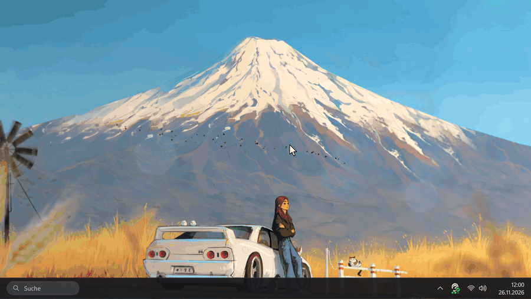

# Kopfhörerpegel / Headphone Level

Live-dB deiner AirPods im Windows-Tray und auf dem Stream Deck, wie „Kopfhörerpegel“ auf dem iPhone.
Live dB of your AirPods in the Windows tray and on your Stream Deck, like the headphone level on iPhone.

**⬇ Kostenlos / Free:** fertige Dateien unter [Releases](https://github.com/Hendrik4K/Kopfhoererpegel/releases/latest):
`Kopfhoererpegel.exe` (Tray-App) und `Headphone-Level.streamDeckPlugin` (Doppelklick installiert es in Stream Deck).
**⭐ Gefällt’s dir? Lass einen Stern da – Leave a star if you like it!**
Lieber unterstützen? Die gleiche Version gibt es für 0,99 € im Elgato Marketplace.

Lizenz: privat kostenlos nutzbar, Weitergeben, Verkaufen und Kopieren nicht erlaubt, siehe [LICENSE.md](LICENSE.md).
License: free for personal use; no redistribution, resale or copies, see [LICENSE.md](LICENSE.md).

| Plattform | Ordner | Technik | Quellen |
| --- | --- | --- | --- |
| Windows | `src/`, `Bauen.ps1` | C# / WPF, WASAPI | AirPods in dB |
| Stream Deck | [`streamdeck/`](#stream-deck) | C#-Plugin, nutzt dieselbe Messung | AirPods in dB auf einer Taste |
| Linux | [`linux/`](linux/README.md) | Python / Qt, PulseAudio · PipeWire | AirPods/Kopfhörer in dB, Mikrofone und Ausgänge in %, Empfänger (dB, % oder Rohwert), Demo |

Beide zeigen dieselbe Karte und dasselbe Tray-Symbol. Die Windows-App ist eigenständig; alles Plattformspezifische der
Linux-Version steckt in `linux/pegel/quellen/linux_pulse.py`.

## Windows

Tray-Symbol für die AirPods: Maus drüber → Karte mit Live-dB im Stil von „Kopfhörerpegel“ auf dem iPhone:
Status mit Symbol (OK grün · Laut gelb ab 80 dB · Sehr laut rot ab 90 dB), dB-Zahl (bei Laut/Sehr laut in der Statusfarbe)
und 18 Segmente à 5 dB von 20 bis 110 dB. Die Leiste füllt sich ruhig mit dem 1-Sekunden-Pegel; nur die beiden vordersten Segmente leben mit dem Beat (Sättigung folgt dem 125-ms-Pegel in festen Stufen: das äußerste 4 Stufen stark, das davor 5 Stufen dezent), alles links davon steht still; die Skala 20 / 80 / 110 bleibt immer gleich. Linksklick pinnt die Karte, nochmal klicken schließt sie.
Die Karte bleibt offen, solange die Maus auf dem Symbol oder auf der Karte ist, und blendet sich erst danach aus.

Rechtsklick macht aus der Karte die Einstellungen: links „Mit Windows starten“ zum Anhaken und „Kalibrierung“, das beim
Drüberfahren −1 dB / +1 dB / Standard (106 dB) ausklappt; rechts der große „Beenden“-Knopf, darunter „Neu starten“ als Link.

Die Karte ist milchig: Beim Öffnen fotografiert sie, was hinter ihr liegt, zeichnet es weich und legt eine dunkle Tönung darüber; große runde Ecken (49 px). Das Hintergrundbild wird nur beim Öffnen aufgenommen, weil Windows-Bildschirmkopien die Karte selbst mit einfangen würden.
Fehler landen in `%LOCALAPPDATA%\Kopfhoererpegel\fehler.log` statt in einem Dialog.

Tray-Symbol: Ohr mit Badge (grüner Haken, gelbes Ausrufezeichen, rotes Warndreieck) und drei Punkten, die mit dem Beat in Stufen pulsieren: OK = Punkt 1 dezent + Punkt 2 stark, Punkt 3 aus; Laut = Punkt 1 ruhig, 2 dezent, 3 stark; Sehr laut = Punkt 1 + 2 ruhig, 3 stark; ohne Wiedergabe kein Badge; AirPods nicht verbunden = kein Symbol (erscheint wieder, sobald sie verbunden sind).

### Wie gemessen wird

Wie beim iPhone **berechnet**, nicht im Ohr gemessen:
WASAPI-Loopback auf dem AirPods-Stereo-Endpunkt (A2DP) → A-Bewertung → 1-Sekunden-Mittel →
+ Windows-Lautstärke der AirPods (Bluetooth-Hardwarelautstärke, Loopback liegt davor) + Kalibrierung (Standard 106 dB).
Der Freisprech-Endpunkt (Hands-Free) wird absichtlich nicht geöffnet, damit die AirPods nicht in den Anrufmodus springen.

Kalibrieren: gleiches Lied am iPhone und am PC bei gleicher Lautstärke vergleichen und per Rechtsklick → Kalibrierung ±1 dB anpassen.
Einstellung liegt in `%LOCALAPPDATA%\Kopfhoererpegel\einstellungen.txt`.

### Bauen / Testen

- `Bauen.ps1` (C#-Compiler aus .NET Framework, kein SDK nötig) → `Kopfhoererpegel.exe`
- `--probe <datei>` listet die Audio-Endpunkte und schreibt 4 s Messwerte in die Datei
- `--demo` zeigt Fantasiewerte, `--show` öffnet die Karte gleich gepinnt
- `--render-tray <ordner>` speichert alle Symbolzustände als PNG
- `--render-icon <datei.ico>` erzeugt das App-Icon (`Kopfhoererpegel.ico`, wird beim Bauen eingebettet)
- `--render-shots <ordner> <hintergrundbild>` rendert die README-Bilder und GIF-Einzelbilder (aufgeräumter Desktop,
  nachgebaute Taskleiste, Mauszeiger); `python tools/gifs.py <ordner> docs` macht daraus `docs/*.gif` und `docs/*.png`

## Stream Deck

Plugin `streamdeck/de.hendrik4k.kopfhoererpegel.sdPlugin`: Aktion „Kopfhörerpegel“ auf eine Taste ziehen.
Die Taste zeigt Status mit Badge, dB-Zahl (bei Laut/Sehr laut in der Statusfarbe) und die 18-Segment-Leiste, deren vorderste
Segmente wie auf der Karte mit dem Beat pulsieren. Drücken wechselt zum Verlauf der letzten 60 Sekunden (Balken in Statusfarbe,
gestrichelte Linie bei 80 dB) und zurück. Ohne AirPods: Ohr + „Nicht verbunden“.

Das Plugin misst selbst (`src/Meter.cs` + `src/CoreAudio.cs` werden mitkompiliert), läuft also auch ohne die Tray-App,
und liest dieselbe Kalibrierung aus `einstellungen.txt`. Gemessen wird nur, solange eine Taste sichtbar ist.
Fehler landen in `%LOCALAPPDATA%\Kopfhoererpegel\streamdeck.log`.

- `streamdeck\Bauen.ps1` baut EXE und Bilder in den Plugin-Ordner
- `-Installieren` kopiert ihn nach `%APPDATA%\Elgato\StreamDeck\Plugins` und startet Stream Deck neu
- `-Paket` erzeugt `Kopfhoererpegel.streamDeckPlugin` (Doppelklick installiert es auf jedem PC)
- `kopfhoererpegel-streamdeck.exe --render <ordner>` speichert alle Tastenzustände als PNG
- Zwei Aktionen: „Pegel“ und „Verlauf“ (Marketplace verlangt mindestens 2); bei „Sehr laut“ blinkt die Taste rot.
  Texte auf der Taste folgen der Stream-Deck-Sprache (Deutsch/Englisch).

### Elgato Marketplace

- Prüfen und packen mit der Elgato-CLI (`npm install -g @elgato/cli`):
  `streamdeck validate de.hendrik4k.kopfhoererpegel.sdPlugin` und `streamdeck pack de.hendrik4k.kopfhoererpegel.sdPlugin`
- `kopfhoererpegel-streamdeck.exe --store streamdeck\marketplace` erzeugt Vorschaubild und 3 Galeriebilder (1920 × 960)
- Texte für Maker Console: `streamdeck/marketplace/listing.md`
